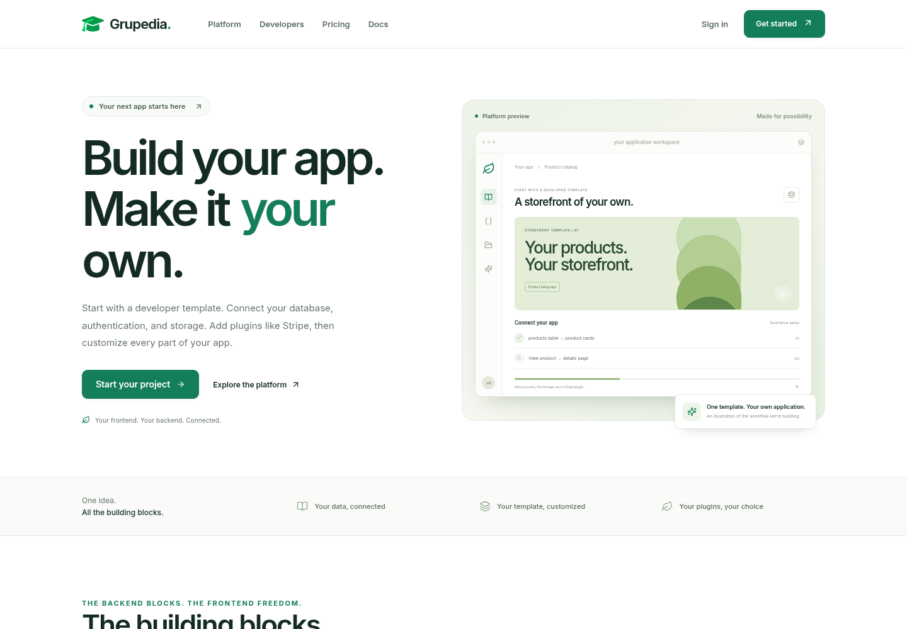

# Grupedia

Interface publique d’une plateforme de création d’applications : base de données Postgres, authentification, stockage, templates de développeurs et plugins. L’identité blanche et vert émeraude et les mises en page mobiles sont conservées.

Grupedia donne une base technique à personnaliser autour de son application. Par exemple, pour créer un catalogue de produits : choisir un template, relier la liste et les boutons de détail à la table `products`, ajouter des comptes clients et le stockage des photos, puis prévoir un plugin Stripe pour les paiements. Ce parcours illustre la vision du produit ; les services métier seront développés ensuite.

## Aperçus



[Voir l’aperçu mobile](docs/previews/home-mobile.png)

[Tarifs et simulateur : ordinateur](docs/previews/pricing-1440.png) · [mobile](docs/previews/pricing-390.png)

## Périmètre

Cette version porte uniquement sur les interfaces : accueil, tarifs, présentation développeurs, connexion et inscription. Toutes les anciennes pages internes (organisations, projets, bases de données, stockage, paramètres et administration) sont supprimées. Les adresses `/dashboard/*` redirigent vers `/coming-soon`, sans charger de données ni vérifier une session auprès du serveur. Cette page d’attente ne contient aucune donnée privée et reste accessible pour prévisualiser le résultat. Les fonctionnalités métier seront développées séparément.

Les illustrations de produit, tarifs et intégrations sont des présentations du concept, pas des services disponibles ni des offres souscriptibles.

## Architecture et tarifs proposés

La [recherche AWS et le modèle économique](docs/aws-architecture-and-pricing.fr.md) détaillent les services recommandés, les coûts officiels vérifiés à Stockholm et les hypothèses. La page `/pricing` présente Free, Pro à 25 $/mois et Team à 99 $/mois, leurs quotas par espace et les dépassements à l’usage. Les prix partagés et l’estimateur proviennent de `src/lib/pricing.js`. Le calcul reste local au navigateur : aucun abonnement ni ressource AWS n’est créé.

## Démarrage

Node.js 20 ou version ultérieure et npm sont nécessaires.

```sh
npm ci
cp .env.example .env.local
npm start
```

Le site est accessible sur `http://localhost:3000`. La vitrine et la page Coming soon fonctionnent sans API.

Les formulaires conservent les contrats de connexion existants : `POST /api/auth/root`, `POST /api/auth/iam` et `POST /api/auth/register`. Définir `REACT_APP_API_URL` dans `.env.local` pour utiliser le serveur existant (par défaut `http://localhost:5000`). La connexion réussie mène à `/coming-soon`, et l’inscription réussie revient à la connexion avec confirmation. Aucun serveur ni nouvelle logique métier ne sont inclus dans ce dépôt.

Les variables `REACT_APP_*` sont publiques dans le navigateur : ne jamais y placer de secret. Les fichiers `.env` locaux ne sont plus suivis par Git.

## Vérification et livraison

```sh
CI=true npm test -- --watchAll=false --runInBand
npm run build
```

Le dossier `build/` contient les fichiers à héberger. L’hébergement doit rediriger les URL inconnues vers `index.html` pour permettre l’ouverture directe de `/login`, `/pricing` ou d’anciennes URL de tableau de bord. Cette branche ne déploie rien automatiquement.

Le projet conserve React et Create React App pour limiter le changement à l’interface. Les styles sont compilés localement : aucune dépendance au script Tailwind chargé à l’exécution. Les polices Inter ont une alternative système si Google Fonts n’est pas disponible.

## Structure

- `src/App.jsx` : routes publiques, titres et redirections.
- `src/router/` : pages de présentation, connexion, inscription et attente.
- `src/components/` : navigation mobile, pied de page, identité et cadre de connexion.
- `src/lib/api.js` : client des formulaires d’authentification existants.

Les anciennes pages restent récupérables dans l’historique Git.
