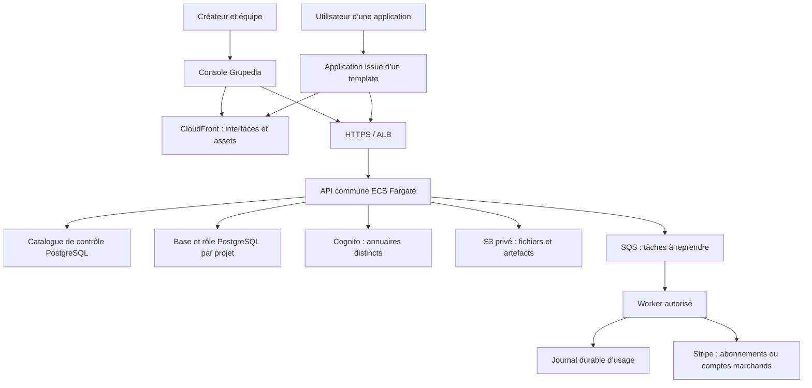

# Grupedia — recherche approfondie et architecture AWS

**Recherche documentaire vérifiée le 1 novembre 2026.** Référence financière : Europe (Stockholm), `eu-north-1`, USD hors taxes et remises, 730 heures/mois. CloudFront est global ; certaines fonctions et certains certificats utilisent une autre région. Ce document propose une architecture : il ne décrit pas un compte AWS audité ni des ressources actuellement déployées. L’aperçu du site demeure une interface sans backend ni facturation activée.

## 1. Recommandation pour le premier produit

Grupedia serait une plateforme pour créer des applications à partir de templates : données, authentification, fichiers, liaisons entre interface et données, puis plugins. Le premier périmètre devrait proposer **des templates statiques approuvés, une API commune, une base logique par projet et des connecteurs maintenus par Grupedia**. L’exécution générale de code serveur tiers, le SSR et le temps réel peuvent venir ensuite, avec un modèle d’isolation et de prix distinct.

Le choix initial cohérent avec le backend Node.js existant est **ECS Fargate + ALB + ECR**, **RDS PostgreSQL**, **Cognito**, **S3 + CloudFront**, **SES** et **SQS**, complétés par réseau, identités techniques, secrets, sauvegardes et supervision. Lambda + API Gateway constitue une alternative pour l’API ; il ne faut pas acheter toutes les alternatives simultanément.

Stockholm sert de point de comparaison parce que le projet s’y référait. Ce n’est pas automatiquement la meilleure région commerciale : comparer latence depuis les pays des utilisateurs, disponibilité des fonctions et exigences de localisation des données avant de la retenir définitivement. Les prix ci-dessous ne s’appliquent pas sans adaptation à Paris, l’Irlande ou à toutes les destinations de diffusion CloudFront.

## 2. Deux espaces produit, deux catégories d’identité

| Ensemble | Ce qu’il contient | Décision de conception |
| --- | --- | --- |
| Contrôle de Grupedia | Créateurs, membres d’équipes, projets, forfaits, templates, déploiements, permissions et factures | API et catalogue internes ; annuaire des opérateurs produit séparé des utilisateurs des applications. |
| Applications clientes | Produits, profils, commandes et autres tables personnalisables, comptes clients et fichiers | Ressources et autorisations rattachées à un projet vérifié ; aucun accès implicite aux autres projets. |
| Exécution développeur | Builds de templates, éventuels plugins serveur et SSR | Environnement distinct du contrôle ; droits, secrets et budgets propres au code exécuté. |

Un compte acheteur d’un site créé avec Grupedia ne doit pas devenir un membre de l’équipe qui administre la plateforme. De même, un app client Cognito ne constitue pas seul une séparation d’annuaires. Cette distinction influence directement les clés API, les tokens, les factures et la suppression d’un projet. [Modèles Cognito multitenants](https://docs.aws.amazon.com/cognito/latest/developerguide/application-client-based-multi-tenancy.html).

Ce schéma est logique : plusieurs composants peuvent partager du calcul au départ. Il ne propose pas une instance ou un conteneur permanent pour chaque application statique. Les téléchargements autorisés vont directement vers S3/CloudFront ; les opérations de données passent par des contrôles d’accès applicatifs.

## 3. Inventaire des services et priorité

**MVP** signifie utile pour le premier périmètre décrit, pas obligation de créer chaque option le premier jour. **Conditionnel** signifie à introduire après un besoin mesuré ou une fonction vendue.

| Service | Rôle concret pour Grupedia | Priorité et choix |
| --- | --- | --- |
| **Amazon S3** | Artefacts des templates publiés, photos, documents, exports et archives du journal d’usage | MVP ; séparer publications et fichiers privés. |
| **Amazon CloudFront** | Distribution HTTPS et cache des interfaces et fichiers autorisés | MVP pour l’hébergement ; contrôler les clés de cache et les accès privés. |
| **Amazon ECS sur Fargate** | Exécuter l’API Node.js et certains workers sans gérer un parc de VM | Choix API initial ; service partagé et dimensionné selon la charge. |
| **Application Load Balancer** | Entrée HTTPS, contrôles de santé et routage vers ECS | Avec l’option ECS ; base horaire, LCU et adresses réseau à chiffrer. |
| **Amazon ECR** | Images versionnées de l’API et des workers | Avec les conteneurs ; rétention des anciennes images. |
| **Amazon RDS PostgreSQL** | Catalogue de contrôle et bases logiques personnalisables des projets | MVP ; Multi-AZ selon la disponibilité proposée. |
| **Amazon Cognito User Pools** | Comptes, mots de passe, tokens et récupération d’accès | Choix d’authentification gérée ; ne remplace pas les permissions sur les données. |
| **Amazon SES** | Invitations, vérifications, réinitialisations et notifications | Avant l’ouverture des parcours e-mail ; accès production et réputation à préparer. |
| **Amazon SQS et DLQ** | Provisionnements, imports, webhooks, miniatures, exports et reprises | MVP dès les premiers traitements différés. |
| **Amazon VPC, subnets, Security Groups** | Garder PostgreSQL privé et borner les flux ALB/API/DB | Socle réseau ; plusieurs AZ pour le scénario disponible. |
| **NAT Gateway / VPC endpoints** | Sortie des tâches privées vers services AWS et API externes | Selon les flux ; comparer coûts et dépendances, pas additionner par défaut. |
| **IAM / IAM Identity Center** | Rôles des composants et accès humains à AWS | Socle ; distinct de l’identité des utilisateurs finaux. |
| **Secrets Manager / Parameter Store** | Secrets sensibles, rotation et configuration | Choisir selon les valeurs ; ne pas stocker chaque secret deux fois. |
| **AWS KMS** | Chiffrement et politiques des clés | Capacités gérées de base ; clés client selon les besoins d’isolement et d’exploitation. |
| **CloudWatch** | Erreurs, latence, connexions DB, files, métriques et alarmes | MVP, avec rétention et volumes maîtrisés. |
| **CloudTrail** | Audit des opérations AWS, conservation dans un trail si nécessaire | Socle d’exploitation ; distinct des logs de l’app et du journal de facturation. |
| **Route 53 / ACM** | DNS et certificats | Selon l’hébergement des domaines ; un fournisseur DNS externe reste possible. |
| **Budgets, Cost Explorer, Cost Anomaly Detection** | Suivi et alertes sur les coûts | MVP ; les limites d’usage doivent aussi être appliquées par Grupedia. |
| **AWS WAF / Shield Standard** | Filtrage HTTP, limitations et protection DDoS des services concernés | Préparer avant l’exposition publique selon les parcours ; WAF ne connaît pas les forfaits clients. |
| **EventBridge** | Routage d’événements vers plusieurs consommateurs | Conditionnel ; SQS peut suffire au début. |
| **Lambda + API Gateway HTTP** | Alternative à l’API ECS et exécution de tâches bornées | Choix alternatif ou worker ciblé ; attention aux limites HTTP et connexions DB. |
| **Aurora Serverless v2 / RDS Proxy** | Élasticité du calcul ou maîtrise des connexions | Conditionnel ; comparer coût, moteur, version et comportement effectif. |
| **CloudFront SaaS Manager** | Gestion de nombreuses applications et de leurs domaines | À évaluer avant l’ouverture des domaines clients à grande échelle. |
| **GitHub Actions OIDC / CodeBuild** | Builds et déploiements automatisés | Choisir un pipeline ; isoler les builds tiers du déploiement de confiance. |
| **AWS Backup** | Gouvernance centralisée de sauvegardes | Complément selon les engagements ; ne pas dupliquer sans comprendre les coûts et la rétention. |
| **AppSync Events / API Gateway WebSocket** | Temps réel et canaux abonnés | Après le cœur données/auth/fichiers, avec compteur et autorisation par canal. |
| **DynamoDB / ElastiCache** | Fort débit d’événements, cache, verrous ou diffusion interne | Seulement si Postgres et les pools applicatifs ne suffisent plus. |
| **Organizations / Control Tower** | Gouvernance de comptes et environnements | Séparer dev/prod ; Control Tower lorsque le nombre de comptes le justifie. |
| **GuardDuty / Inspector / Security Hub / Config** | Détection, vulnérabilités et contrôle de configuration | Renforcement progressif, en particulier avant du code tiers et des engagements plus forts. |

Les justifications, limites et références officielles sont détaillées dans les [quatre dossiers techniques](#10-dossiers-techniques-et-sources). EKS, OpenSearch, Transit Gateway, Direct Connect, une architecture multirégion ou Shield Advanced ne sont pas des prérequis pour le premier catalogue de produits.

## 4. Les décisions qui évitent une architecture inadaptée

### Données personnalisables et API

Pour les tables arbitraires des applications, recommander **une base logique et un rôle par projet sur RDS partagé**, avec une base de contrôle distincte. Les schémas séparés ou les tables communes avec RLS sont des alternatives, pas un seul modèle interchangeable. Les rôles de migration doivent être distincts des rôles utilisés par le trafic courant ; borner connexions, durée des requêtes et consommation de chaque projet. [Modèles PostgreSQL AWS](https://docs.aws.amazon.com/prescriptive-guidance/latest/saas-multitenant-managed-postgresql/matrix.html).

L’API doit générer ou exposer les opérations autorisées et appliquer les permissions : acheter RDS ou API Gateway ne crée pas l’éditeur visuel, le CRUD métier, les liaisons boutons→actions ou les politiques de lecture/écriture. Le quota commercial « 8 Go » correspond à du stockage logique, pas à 8 Go de RAM ni à une instance dédiée.

Aurora peut être pertinent plus tard. Sa pause à zéro requiert des versions et réglages compatibles, le stockage reste payant, et des connexions persistantes ou un proxy peuvent empêcher la pause. Une base mutualisée active toute la journée n’économise pas nécessairement du calcul grâce à cette option. [Conditions Aurora](https://docs.aws.amazon.com/AmazonRDS/latest/AuroraUserGuide/aurora-serverless-v2-auto-pause.html).

### Authentification et personnalisation

Choisir d’abord le modèle d’annuaire des utilisateurs finaux : pool Cognito par projet, ou annuaire partagé avec une convention d’identité et des autorisations solides. Préférer une interface de login du template et une identité correctement bornée plutôt que promettre un domaine d’authentification distinct sans limite. Les quotas actuels incluent notamment **4 domaines Cognito personnalisés par compte AWS et par région**, **20 styles managed-login par pool** et des quotas régionaux de requêtes. Les limites du compte doivent être vérifiées avant une capacité commerciale. [Quotas Cognito](https://docs.aws.amazon.com/cognito/latest/developerguide/quotas.html).

Lite réduit le coût de l’authentification de base ; les fonctions avancées de personnalisation des access tokens et certaines expériences d’identité peuvent exiger Essentials/Plus. Ne pas baser le cloisonnement sur un attribut librement modifiable ou un identifiant simplement envoyé par le navigateur. [Personnalisation des tokens](https://docs.aws.amazon.com/cognito/latest/developerguide/user-pool-lambda-pre-token-generation.html).

### Hébergement et domaines

Une application React statique se distribue depuis S3 privé via CloudFront OAC, avec versions immuables et retour au déploiement précédent. Un template SSR ou serveur nécessite un runtime supplémentaire ; il n’est pas inclus automatiquement dans l’hébergement statique. Les fichiers privés demandent toujours une autorisation, même avec un bucket inaccessible directement au public.

La console d’administration et les applications personnalisables doivent utiliser des origines distinctes. Éviter de partager les cookies d’administration sur un domaine parent accessible aux apps ; une règle CORS ne remplace pas les permissions serveur. Le code du template reçoit les droits de son projet et de son utilisateur, pas la session propriétaire de Grupedia. C’est une recommandation de séparation des contextes, à conserver également pour les previews et les plugins navigateur.

Commencer par des sous-domaines maîtrisés par Grupedia. Pour les domaines clients, orchestrer preuve de propriété, certificat, DNS, association au projet et suppression propre. Les certificats CloudFront sont en `us-east-1`, ceux d’un ALB dans sa région ; cela ne change pas la région de la base. [Certificats ACM](https://docs.aws.amazon.com/acm/latest/userguide/acm-overview.html).

SaaS Manager réduit les configurations répétées pour les domaines. Sa tarification s’ajoute au trafic : dix premiers distribution tenants gratuits, puis 20 $/mois jusqu’à 200, puis 0,10 $ par tenant au-delà. Les forfaits fixes CloudFront ne sont pas compatibles avec les distributions multitenant. [CloudFront PAYG](https://aws.amazon.com/cloudfront/pricing/pay-as-you-go/), [restrictions des forfaits](https://docs.aws.amazon.com/AmazonCloudFront/latest/DeveloperGuide/flat-rate-pricing-plan.html).

### Templates et plugins

Au MVP, accepter des templates et connecteurs revus par l’équipe. Le build d’un template peut exécuter des scripts de dépendances : il doit être séparé du rôle qui publie en production. L’exécution d’un plugin tiers dans l’API centrale lui donnerait le contexte et potentiellement les secrets de toute la plateforme.

Fargate isole des tâches, pas des plugins dans le même processus. Le mode tenant isolation de Lambda sépare les environnements mais **conserve un rôle d’exécution commun**. Il ne suffit donc pas si ce rôle peut lire les ressources de tous les projets. L’exécution générale de code tiers constitue un produit distinct à concevoir et financer. [Isolation Lambda](https://docs.aws.amazon.com/lambda/latest/dg/tenant-isolation.html).

## 5. Parcours concret d’une application de produits

1. Le créateur choisit une version approuvée du template. Grupedia enregistre le projet, son propriétaire et le forfait.
2. Un travail idempotent crée la base et les rôles, les paramètres d’authentification et le périmètre de fichiers. Un échec reprend sans créer des ressources orphelines ou doubles.
3. L’éditeur associe la liste à `products`, le bouton de détail à une lecture autorisée et le formulaire à une écriture validée. Ces liaisons sont des métadonnées versionnées de Grupedia.
4. Le template publié utilise des identifiants publics de projet et des tokens autorisés ; les secrets d’administration restent côté serveur.
5. Une photo se téléverse par URL signée après contrôle du projet, de la taille et du quota. Le produit publié ne rend pas tous les autres objets publics.
6. Le connecteur de paiement associe le bon compte marchand. Les webhooks sont vérifiés, stockés, dédupliqués puis traités via une file.
7. Les opérations alimentent un journal d’usage durable. L’agrégation calcule utilisateurs distincts, octets-heures stockés, requêtes et trafic selon le contrat, puis rapproche les montants avant facture.
8. La suppression révoque tokens, domaines et accès, puis traite données, versions, backups et obligations de conservation suivant une politique définie.

SQS Standard livre au moins une fois : la déduplication est applicative. Les logs S3 et CloudFront sont fournis au mieux ; ils ne doivent pas être l’unique registre de facturation. [SQS](https://docs.aws.amazon.com/AWSSimpleQueueService/latest/SQSDeveloperGuide/standard-queues-at-least-once-delivery.html), [logs S3](https://docs.aws.amazon.com/AmazonS3/latest/userguide/ServerLogs.html).

## 6. Paiements : abonnement Grupedia et ventes des clients

Facturer un forfait Grupedia et ses dépassements relève d’un abonnement et d’un moteur de consommation. Les achats réalisés sur les applications clientes sont un autre flux : Stripe Connect peut modéliser les comptes marchands et les transferts ; ce n’est pas un service AWS. Vérifier disponibilité par pays, types de compte et responsabilités avant de promettre un plugin marchand universel. [Stripe Connect pour SaaS](https://docs.stripe.com/connect/saas).

Le détail du choix actuel de moteur d’usage et des webhooks figure dans le dossier 4. Les événements acceptés tardivement, doublons et corrections doivent être traités avant finalisation de la facture ; un simple compteur en mémoire ou une alarme AWS n’est pas un système de facturation.

## 7. Réseau, exploitation et récupération

Placer RDS dans des sous-réseaux privés ; autoriser uniquement les flux nécessaires depuis l’API. Pour des tâches privées, choisir la sortie NAT et les endpoints selon les destinations réelles : **un endpoint AWS ne donne pas accès à Stripe**. Des endpoints multiples dans plusieurs AZ peuvent coûter davantage qu’un NAT peu sollicité. Le gateway endpoint S3 est gratuit pour ses frais propres. [Connectivité ECS](https://docs.aws.amazon.com/AmazonECS/latest/developerguide/networking-connecting-vpc.html).

CloudWatch sert aux performances ; CloudTrail à l’audit AWS ; le journal d’usage à la facturation. Ce sont trois fonctions distinctes. Fixer une rétention, surveiller erreurs, latence, connexions SQL, files et coût des logs. Budgets et détection d’anomalies alertent avec retard : les plafonds doivent être appliqués dans Grupedia avant la consommation. [Budgets AWS](https://docs.aws.amazon.com/cost-management/latest/userguide/budgets-managing-costs.html).

Une sauvegarde ou un basculement Multi-AZ ne restaure pas automatiquement un seul projet supprimé par erreur. Pour un PITR RDS, créer une instance temporaire, exporter la base du projet et réimporter suivant une procédure contrôlée. Prévoir une récupération cohérente des fichiers et une restauration réellement testée avant d’annoncer des objectifs RPO/RTO. [PITR RDS](https://docs.aws.amazon.com/AmazonRDS/latest/UserGuide/USER_PIT.html).

L’accès humain à AWS, les rôles API, les builds et les workers doivent être séparés. Une stratégie de comptes dev/prod est utile ; un compte AWS par client n’est pas requis pour le modèle mutualisé. La chaîne de déploiement utilise des identifiants temporaires, par exemple GitHub OIDC, et non les secrets de production injectés dans des builds tiers. [OIDC GitHub/AWS](https://docs.aws.amazon.com/IAM/latest/UserGuide/id_roles_create_for-idp_oidc.html).

## 8. Deux budgets explicites pour le socle

Ce sont **des modèles comptables partiels**, pas un devis AWS, une facture prévue ni une garantie de capacité. Ils n’indiquent pas combien de clients une taille de DB peut servir. Aucune gratuité par compte, crédit ou remise n’est utilisé. Les données variables et services complémentaires ci-dessous restent à ajouter.

- **Pilote** : une tâche Fargate Linux x86 à 0,25 vCPU/0,5 Go ; RDS `db.t4g.small` Single-AZ, 20 GiB gp3 ; un ALB public, hypothèse de deux IPv4 et d’une moyenne de 1 LCU ; un NAT classique avec une IPv4. Ce scénario n’est pas hautement disponible.
- **Production à disponibilité renforcée** : deux tâches à 0,5 vCPU/1 Go ; RDS `db.t4g.medium` Multi-AZ classique, 100 GiB gp3 ; ALB et hypothèse LCU identiques ; deux NAT et leurs IPv4 dans deux AZ. La taille choisie reste une hypothèse à tester, pas une recommandation de capacité pour une charge inconnue.
- Pour les deux : cinq secrets, une clé KMS client et une zone DNS ; enveloppe CloudWatch de 10 ou 20 $, **réserve choisie et non forfait AWS**.

| Poste mensuel, 730 h | Pilote | Production renforcée |
| --- | ---: | ---: |
| Calcul RDS | 24,09 $ | 94,90 $ |
| Stockage gp3 RDS | 2,40 $ | 24,00 $ |
| Fargate calcul + mémoire | 9,91 $ | 39,64 $ |
| ALB fixe + hypothèse 1 LCU | 23,02 $ | 23,02 $ |
| Hypothèse 2 IPv4 de l’ALB | 7,30 $ | 7,30 $ |
| NAT : frais horaires | 33,58 $ | 67,16 $ |
| IPv4 des NAT | 3,65 $ | 7,30 $ |
| 5 secrets, 1 clé KMS, 1 zone DNS | 3,50 $ | 3,50 $ |
| Enveloppe CloudWatch choisie | 10,00 $ | 20,00 $ |
| **Total du socle modélisé** | **117,45 $** | **286,82 $** |

Les totaux sont calculés à partir des valeurs non arrondies ; les lignes affichées sont arrondies. Le [CSV des hypothèses et calculs](aws-research/05-hypotheses-budget.csv) permet de modifier chaque taux et quantité. Le Multi-AZ classique à 0,13 $/h et 0,24 $/GB-mois comprend déjà sa réplication : ne pas le doubler une seconde fois.

Sources régionales : [RDS](https://pricing.us-east-1.amazonaws.com/offers/v1.0/aws/AmazonRDS/current/eu-north-1/index.json), [ECS](https://pricing.us-east-1.amazonaws.com/offers/v1.0/aws/AmazonECS/current/eu-north-1/index.json), [ALB](https://pricing.us-east-1.amazonaws.com/offers/v1.0/aws/AWSELB/current/eu-north-1/index.json), [IPv4](https://pricing.us-east-1.amazonaws.com/offers/v1.0/aws/AmazonVPC/current/eu-north-1/index.json), [NAT](https://pricing.us-east-1.amazonaws.com/offers/v1.0/aws/AmazonEC2/current/eu-north-1/index.csv), [Secrets](https://pricing.us-east-1.amazonaws.com/offers/v1.0/aws/AWSSecretsManager/current/eu-north-1/index.json), [KMS](https://pricing.us-east-1.amazonaws.com/offers/v1.0/aws/awskms/current/eu-north-1/index.json), [DNS](https://aws.amazon.com/route53/pricing/).

**À ajouter** : Cognito et e-mails, stockage S3 et opérations, trafic CloudFront/Internet et inter-AZ, traitement NAT à 0,046 $/Go, LCU réelles au-delà de l’hypothèse, appels Secrets/KMS, ECR, builds, webhooks, workers, WAF, sauvegardes excédentaires, crédits CPU excédentaires des instances RDS T4g, temps réel, frais Stripe, support et taxes. L’ALB peut utiliser plus de deux IPv4 ; un réseau IPv6 ou d’autres origines CloudFront changent le calcul. Ces variantes ne sont pas supposées dans les chiffres affichés.

Les instances RDS T4g fonctionnent en mode Unlimited ; une consommation CPU durable au-dessus de leur référence peut ajouter **0,075 $/vCPU-heure** de crédits. Ce supplément n’est pas inclus dans les scénarios. [Tarification des crédits RDS](https://aws.amazon.com/rds/postgresql/pricing/).

Les forfaits clients à 25 ou 99 $ doivent financer une part de ce socle **et** l’usage propre au client. Le coût DB n’est pas son seul nombre de Go ; le calcul et les connexions comptent. Pour les détails de prix variables, les quotas commerciaux et l’exemple Pro à 38,25 $, voir [le modèle tarifaire séparé](aws-architecture-and-pricing.fr.md). Ne pas extrapoler une marge garantie ou un nombre de clients par serveur depuis les seuls quotas marketing.

## 9. Ordre de réalisation

| Phase | Livrables | Condition pour passer à la suite |
| --- | --- | --- |
| 1 — Contrôle et données | Environnements, identités propriétaires, catalogue, création de projet, base/rôle isolés, API autorisée, secrets, logs et backups | Une création se reprend après échec ; accès interprojets refusé et restauration vérifiée. |
| 2 — Application publiable | Template approuvé, données liées à l’interface, auth des utilisateurs, uploads, publication statique et sous-domaine | Une application complète peut être publiée puis restaurée à une version précédente. |
| 3 — Offre payante | Journal d’usage, quotas/plafonds, rapprochement, abonnement, webhooks et procédure de correction | Les compteurs et factures sont vérifiables sur des scénarios réels, sans double comptage. |
| 4 — Écosystème | Domaines clients, catalogue de templates/plugins versionnés, installations avec permissions, builds isolés | Domaine vérifié, désinstallation/révocation et isolation de l’exécution testées. |
| 5 — Capacités avancées | SSR, temps réel, fonctions serveur tiers, Aurora/réplicas ou offres dédiées | Besoin confirmé, métriques de charge et modèle économique propre à chaque capacité. |

Avant de provisionner l’infrastructure, fixer les pays visés, le niveau de disponibilité vendu, le modèle d’identité par app et le périmètre exact des templates/plugins. Ces décisions servent au dimensionnement ; le présent rapport ne lance aucun service.

## 10. Dossiers techniques et sources

1. [Données, PostgreSQL, Aurora, sauvegardes, Cognito et quotas](aws-research/01-donnees-et-authentification.md).
2. [API, hébergement, domaines, builds et exécution des plugins](aws-research/02-hebergement-domaines-et-plugins.md).
3. [Réseau, IAM, secrets, exploitation, protection et coûts cachés](aws-research/03-reseau-securite-et-exploitation.md).
4. [S3, événements, facturation, SES et temps réel](aws-research/04-stockage-evenements-et-facturation.md).
5. [Hypothèses de budget, taux unitaires et quantités — CSV](aws-research/05-hypotheses-budget.csv).
6. [Trésorerie de démarrage, développement et réserve sur six mois](budget-demarrage-grupedia.fr.md), avec son [CSV](aws-research/06-budget-demarrage.csv).
7. [Coûts AWS et prix de vente proposés pour chaque consommation](prix-grupedia-bases-sur-aws.fr.md).

Les références sont celles des documentations et catalogues officiels AWS, ainsi que Stripe pour les flux de paiement. Les chiffres de quotas sont des capacités documentées au jour de recherche ; ils ne prouvent pas les quotas accordés à un compte précis. Les annonces, prix, fonctions et conditions doivent être revérifiés avant l’achat. Aucune ressource AWS, facturation ou modification de l’interface n’a été effectuée pour cette recherche.
